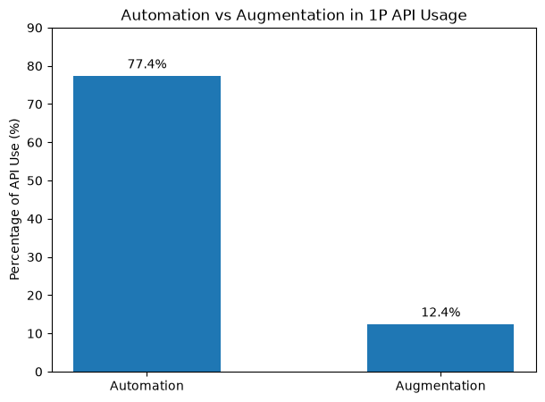
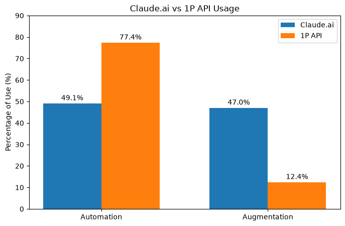
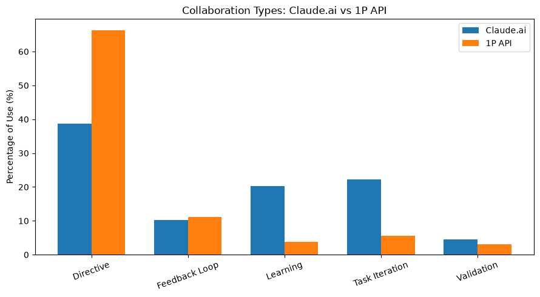
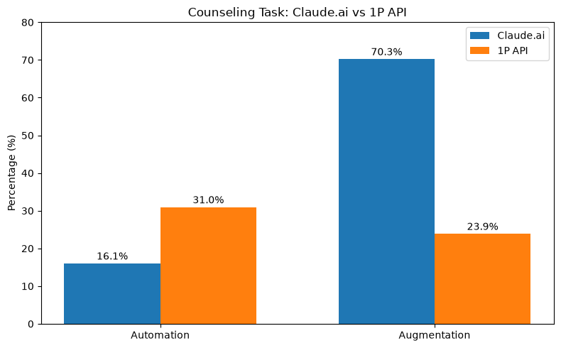
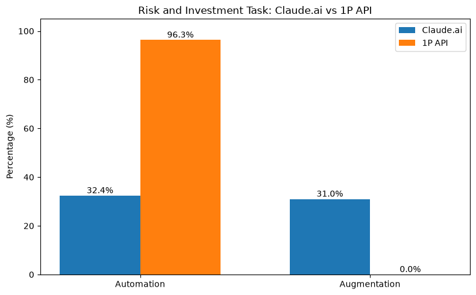
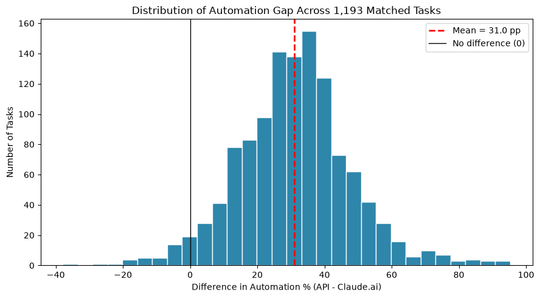
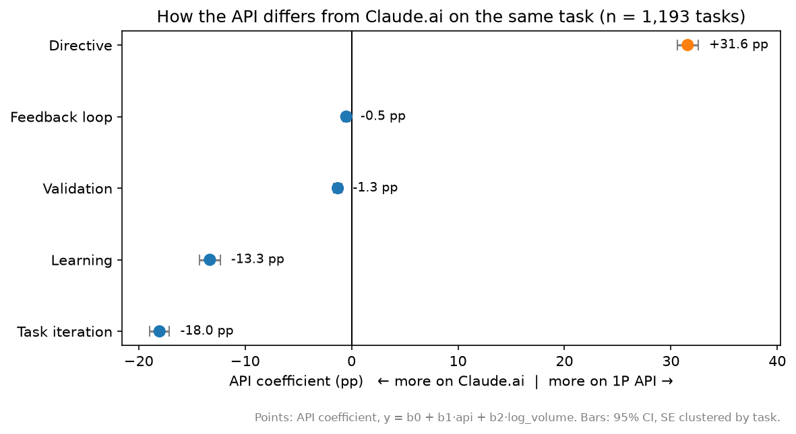
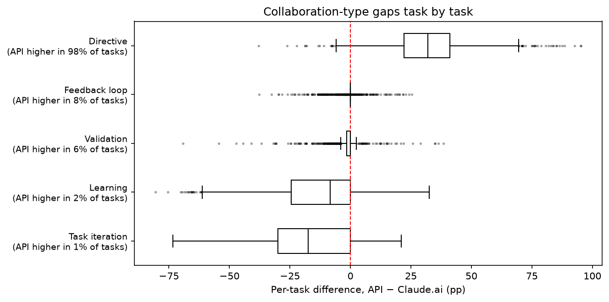
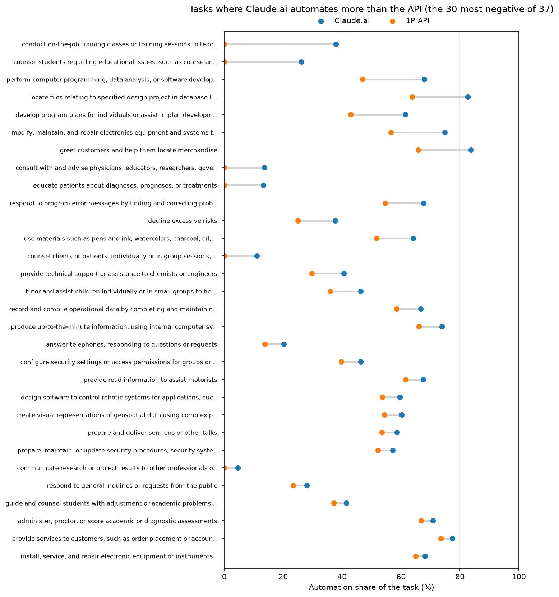
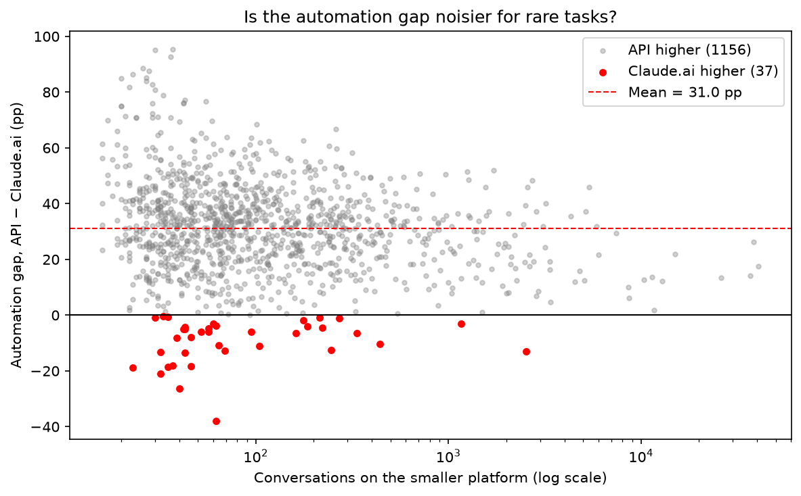

# Data Profile

## 1P API: Automation vs Augmentation

**Figure 1.** Automation is much more common than augmentation in the 1P API data. About 77.4% of API use is automation, while about 12.4% is augmentation.

## Claude.ai vs 1P API

**Figure 2.** Claude.ai has similar levels of automation and augmentation. In comparison, 1P API use is much more focused on automation. This shows a clear difference between consumer and business AI use.

## Collaboration Types

**Figure 3.** The largest difference is in directive use, which is much higher for the 1P API. Claude.ai has higher percentages for learning and task iteration. This suggests that business API use is more focused on direct task completion, while consumer use includes more interactive collaboration.

## Same-Task Analysis

This week, I extended the analysis to compare Claude.ai and 1P API usage on the same O*NET tasks. I selected two tasks from the dataset and compared their collaboration patterns.

### Task 1: Counseling

The first task was:

"Advise clients on how they could be helped by counseling."

For this task, the 1P API had 30.98% automation and 23.91% augmentation. Claude.ai had 16.06% automation and 70.26% augmentation.

This task shows a large difference between the two platforms. Claude.ai had much more augmentation, especially because learning was 56.93%. The API had a higher automation percentage than Claude.ai.

### Task 2: Risk and Investment

The second task was:

"Analyze and classify risks and investments to determine their potential impacts on companies."

For this task, the 1P API had 96.32% automation and no usage classified as augmentation. Claude.ai had 32.39% automation and 30.99% augmentation.

The API usage for this task was almost entirely directive, while Claude.ai showed both directive and learning patterns.

### Initial Observation

These two examples show that Claude.ai and the 1P API can have different collaboration patterns even when they are used for the same O*NET task. This provides an initial example related to my research question: "Do consumers and businesses use AI differently on the same tasks?"

These results are based on only two selected tasks, so more tasks need to be analyzed before making a general conclusion.

## Hypotheses

Do consumers (Claude.ai) and businesses (1P API) use AI differently on the
same tasks? Specifically, I wanted to know whether businesses lean more
toward full automation while individual users lean more toward augmentation,
even when working on the exact same O*NET task.

| | Statement |
|---|---|
| **H0** | No difference in automation share between API and Claude.ai for the same task: `mean(diff) = 0` |
| **H1** | Automation share is systematically higher on the API than on Claude.ai: `mean(diff) > 0`, where `diff(t) = automation%_API(t) - automation%_ClaudeAI(t)` |

**Reasoning:** businesses using the API are usually optimizing for cost and
efficiency, pushing tasks toward full automation. Individual users on
Claude.ai are more often learning, exploring, or want to stay in control of
the process, so they stay closer to augmentation.

## Data and Method
Data: Aug 2025 release (`aei_raw_1p_api_2025-08-04_to_2025-08-11.csv` and
`aei_raw_claude_ai_2025-08-04_to_2025-08-11.csv`). For each source, I
filtered to task-level collaboration data
(`facet == "onet_task::collaboration"`, `variable ==
"onet_task_collaboration_pct"`), split `cluster_name` into task name and
collaboration type, and grouped collaboration types into two buckets:

- **Automation** = directive + feedback loop
- **Augmentation** = learning + task iteration + validation

I matched every task present in both sources (global level) and computed
`diff = automation%_API - automation%_ClaudeAI` for each of the 1,193
matched tasks. To test H1, I ran a one-tailed paired t-test
(`scipy.stats.ttest_rel`, `alternative = "greater"`).

## Results

| Metric | Value |
|---|---|
| Matched tasks (n) | **1,193** |
| Mean diff (API − Claude.ai) | **+31.03 pp** |
| Median diff | **+31.43 pp** |
| t-statistic | **63.26** |
| p-value | **< .001** |
| Conclusion | **Reject H0 → H1 supported** |

The p-value is far below the 0.05 threshold, so H0 is rejected in favor of
H1. Across almost all matched tasks, the API automation share is higher
than the Claude.ai automation share by about 31 percentage points on
average — a large, statistically significant gap unlikely to be due to
random noise.

## Distribution of the Automation Gap

The histogram above shows the difference in automation percentage
(API − Claude.ai) for all 1,193 matched tasks. Almost all tasks fall to the
right of zero, meaning the API automation share is higher than Claude.ai's
for nearly every task, not just on average. The distribution is roughly
bell-shaped and centered near the mean (31.0 pp), which supports using a
paired t-test — the test assumes the differences are roughly normally
distributed. The small number of tasks on the left side (negative values)
represent the few cases where Claude.ai had a higher automation share than
the API.

## Regression Model

To control for other factors, I extended the paired t-test into a multiple
linear regression. Each matched task appears twice (once per platform),
giving 2,386 observations (1,193 tasks × 2 platforms).

    automation_pct = β0 + β1·api + β2·log_volume + ε

- `api`: dummy variable (1 = 1P API, 0 = Claude.ai)
- `log_volume`: log of the task's conversation count on that platform
- Standard errors are clustered by task, since the two rows of a task are
  not independent.

### Robustness Checks

| | (1) api only | (2) + log_volume | (3) + unclassified |
|---|---|---|---|
| api | 31.029*** | 31.082*** | 31.847*** |
| log_volume | | 0.181 | -2.207*** |
| unclassified_pct | | | -0.491*** |
| R² | 0.475 | 0.475 | 0.555 |
| N | 2,386 | 2,386 | 2,386 |

*** p < 0.01

The API coefficient stays between 31 and 32 percentage points and is
significant at the 1% level in every specification. Model (1) reproduces
the paired t-test (mean difference = 31.03 pp). The gap is not explained by
usage volume or by the share of unclassified conversations.

The sign change of `log_volume` between models (2) and (3) is an example of
omitted variable bias: high-volume tasks have a lower unclassified share,
so `log_volume` was partly picking up the effect of `unclassified_pct`.
## How Do They Differ? Collaboration Types on the Same Task

The regression shows *that* businesses automate more. The next question is
*how*: which kinds of collaboration does the API use more, and which does
Claude.ai use more? For each of the 1,193 matched tasks, I compared the five
collaboration types one by one (`src/how_and_negatives.py`). For each type I
ran the same regression as the main model
(`share = β0 + β1·api + β2·log_volume + ε`, standard errors clustered by task).

| Collaboration type | Claude.ai (mean %) | API (mean %) | API coefficient (pp) | API higher in | Claude.ai higher in |
|---|---|---|---|---|---|
| Directive | 40.8 | 72.8 | **+31.6** | 97.6% of tasks | 2.4% of tasks |
| Feedback loop | 2.9 | 1.9 | −0.5 | 8.4% | 23.6% |
| Learning | 17.5 | 3.5 | **−13.3** | 2.4% | 58.6% |
| Task iteration | 20.5 | 2.0 | **−18.0** | 0.5% | 74.5% |
| Validation | 3.5 | 1.9 | −1.3 | 5.8% | 29.6% |

All five differences are significant at the 1% level, also after a
Bonferroni correction for running five tests. (The two right-hand columns
do not add up to 100% because in many tasks both platforms have 0% for that
type.)

**Figure 4.** The API effect for each collaboration type, with 95% confidence
intervals. The automation gap comes almost entirely from **directive** use.
Feedback loop, the second automation type, barely differs. On the other side,
the API loses mostly **task iteration** and **learning**.

**Figure 5.** The same comparison task by task. Each box shows how the gap
(API − Claude.ai) is spread across the 1,193 tasks. The directive box sits
almost completely to the right of zero, and the task iteration and learning
boxes to the left. So the pattern is not only an average: it holds for
nearly every individual task.

### The Main Shift in Each Task

For every task, I also checked which type gains the most on the API and
which type gains the most on Claude.ai:

| Main shift (Claude.ai → API) | Tasks | Share |
|---|---|---|
| task iteration → directive | 560 | 46.9% |
| learning → directive | 412 | 34.5% |
| feedback loop → directive | 148 | 12.4% |
| validation → directive | 19 | 1.6% |
| all other combinations | 54 | 4.5% |

In about 95% of tasks, the type that grows the most on the API is directive.

### Interpretation

On the same task, businesses mostly give Claude a single instruction and take
the result (directive). Consumers work on the task together with Claude,
refining the output over several turns (task iteration) or using it to
understand the topic (learning). In other words, the difference is not
"more automation in general", it is **one-shot delegation vs. working
together**.

Two notes:

- The five shares and the unclassified share add up to 100% within a task,
  so the coefficients balance each other: what the API gains in directive,
  it loses mainly in task iteration and learning.
- In the global numbers (Figure 3), feedback loop is about 11% of API use,
  but the task-level average is only 1.9%. Global numbers are weighted by
  volume, while my task averages give every task the same weight. This
  suggests that feedback loop is concentrated in a few very large tasks
  (for example debugging code).

## Exceptions: Tasks Where Claude.ai Automates More

In 37 of the 1,193 tasks (3.1%), Claude.ai has a *higher* automation share
than the API.

**Figure 6.** The 30 most negative tasks. Blue = Claude.ai, orange = 1P API.
In 7 tasks the API automation share is exactly 0%. The full list is in
`tables/negative_tasks.csv`.

### Are These Exceptions Just Noise?

A first idea was that these are rare tasks with only a few conversations,
where the percentages are unreliable. I compared the negative tasks with
all other tasks:

| Median | Negative tasks (37) | Other tasks (1,156) |
|---|---|---|
| API conversations | 62 | 112 |
| Claude.ai conversations | 225 | 152 |
| API unclassified share | **38.5%** | **14.6%** |
| Claude.ai unclassified share | 6.7% | 8.4% |

**Figure 7.** The automation gap of each task against its number of
conversations (on the platform with fewer conversations), on a log scale.
If the exceptions were mainly noise, the negative tasks (red) would be
grouped at the low-volume end on the left.

The volume explanation does not hold: a Mann-Whitney test finds no
significant difference in volume (p = 0.25). The clear difference is the
**unclassified share on the API**: it is 38.5% for the negative tasks, more
than twice the 14.6% of other tasks. Because the automation share is
calculated over *all* conversations, a high unclassified share pulls the
API's automation share down. So some of these exceptions are probably a
measurement effect rather than a real difference in behavior.

### What Kind of Tasks Are They?

Looking at the task texts, two groups stand out:

- **Education and counseling:** training sessions, counseling students,
  educating patients, counseling clients, tutoring children, preparing and
  grading tests.
- **Technical support and repair:** repairing electronics, fixing program
  errors, calibrating equipment.

A possible explanation for the first group is that businesses use the API
inside products that are designed to teach or support a person (for example
education or counseling apps), so even business use looks like augmentation.
The data cannot prove this, but it fits the pattern.

