# Data Profile

## 1P API: Automation vs Augmentation

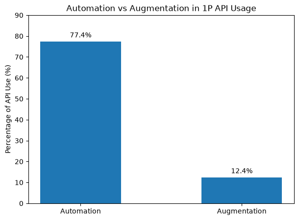

**Figure 1.** Automation is much more common than augmentation in the 1P API data. About 77.4% of API use is automation, while about 12.4% is augmentation.

## Claude.ai vs 1P API

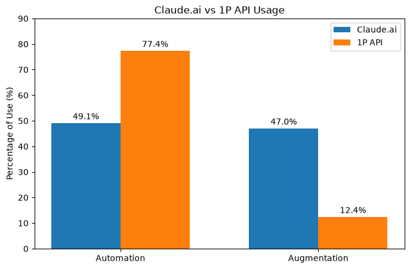

**Figure 2.** Claude.ai has similar levels of automation and augmentation. In comparison, 1P API use is much more focused on automation. This shows a clear difference between consumer and business AI use.

## Collaboration Types

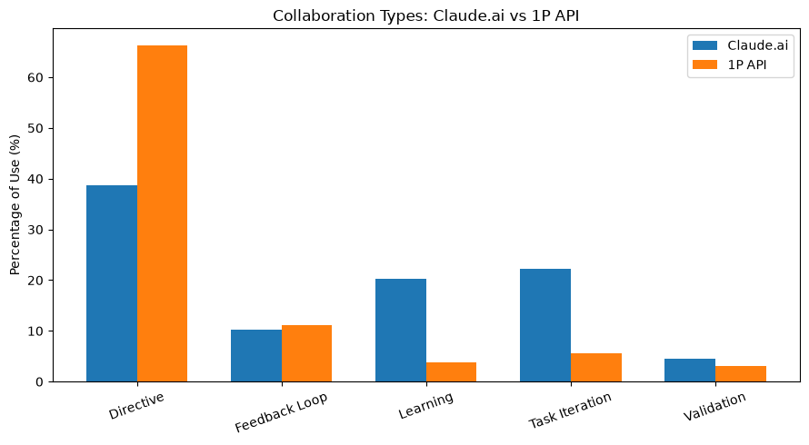

**Figure 3.** The largest difference is in directive use, which is much higher for the 1P API. Claude.ai has higher percentages for learning and task iteration. This suggests that business API use is more focused on direct task completion, while consumer use includes more interactive collaboration.

## Same-Task Analysis

This week, I extended the analysis to compare Claude.ai and 1P API usage on the same O*NET tasks. I selected two tasks from the dataset and compared their collaboration patterns.

### Task 1: Counseling

The first task was:

"Advise clients on how they could be helped by counseling."

For this task, the 1P API had 30.98% automation and 23.91% augmentation. Claude.ai had 16.06% automation and 70.26% augmentation.

This task shows a large difference between the two platforms. Claude.ai had much more augmentation, especially because learning was 56.93%. The API had a higher automation percentage than Claude.ai.

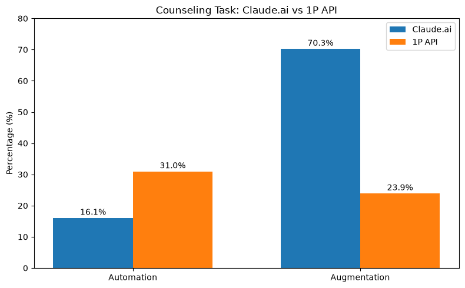

### Task 2: Risk and Investment

The second task was:

"Analyze and classify risks and investments to determine their potential impacts on companies."

For this task, the 1P API had 96.32% automation and no usage classified as augmentation. Claude.ai had 32.39% automation and 30.99% augmentation.

The API usage for this task was almost entirely directive, while Claude.ai showed both directive and learning patterns.

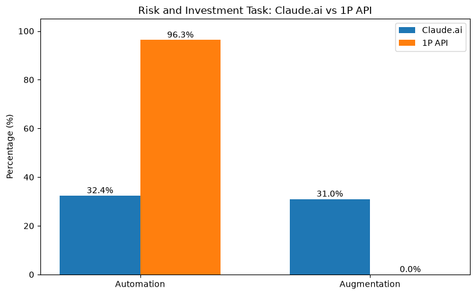

### Initial Observation

These two examples show that Claude.ai and the 1P API can have different collaboration patterns even when they are used for the same O*NET task. This provides an initial example related to my research question: "Do consumers and businesses use AI differently on the same tasks?"

These results are based on only two selected tasks, so more tasks need to be analyzed before making a general conclusion.

## Hypotheses

Do consumers (Claude.ai) and businesses (1P API) use AI differently on the
same tasks? Specifically, I wanted to know whether businesses lean more
toward full automation while individual users lean more toward augmentation,
even when working on the exact same O*NET task.

| | Statement |
|---|---|
| **H0** | No difference in automation share between API and Claude.ai for the same task: `mean(diff) = 0` |
| **H1** | Automation share is systematically higher on the API than on Claude.ai: `mean(diff) > 0`, where `diff(t) = automation%_API(t) - automation%_ClaudeAI(t)` |

**Reasoning:** businesses using the API are usually optimizing for cost and
efficiency, pushing tasks toward full automation. Individual users on
Claude.ai are more often learning, exploring, or want to stay in control of
the process, so they stay closer to augmentation.

## Data and Method
Data: Aug 2025 release (`aei_raw_1p_api_2025-08-04_to_2025-08-11.csv` and
`aei_raw_claude_ai_2025-08-04_to_2025-08-11.csv`). For each source, I
filtered to task-level collaboration data
(`facet == "onet_task::collaboration"`, `variable ==
"onet_task_collaboration_pct"`), split `cluster_name` into task name and
collaboration type, and grouped collaboration types into two buckets:

- **Automation** = directive + feedback loop
- **Augmentation** = learning + task iteration + validation

I matched every task present in both sources (global level) and computed
`diff = automation%_API - automation%_ClaudeAI` for each of the 1,193
matched tasks. To test H1, I ran a one-tailed paired t-test
(`scipy.stats.ttest_rel`, `alternative = "greater"`).

## Results

| Metric | Value |
|---|---|
| Matched tasks (n) | **1,193** |
| Mean diff (API − Claude.ai) | **+31.03 pp** |
| Median diff | **+31.43 pp** |
| t-statistic | **63.26** |
| p-value | **< .001** |
| Conclusion | **Reject H0 → H1 supported** |

The p-value is far below the 0.05 threshold, so H0 is rejected in favor of
H1. Across almost all matched tasks, the API automation share is higher
than the Claude.ai automation share by about 31 percentage points on
average — a large, statistically significant gap unlikely to be due to
random noise.

## Distribution of the Automation Gap

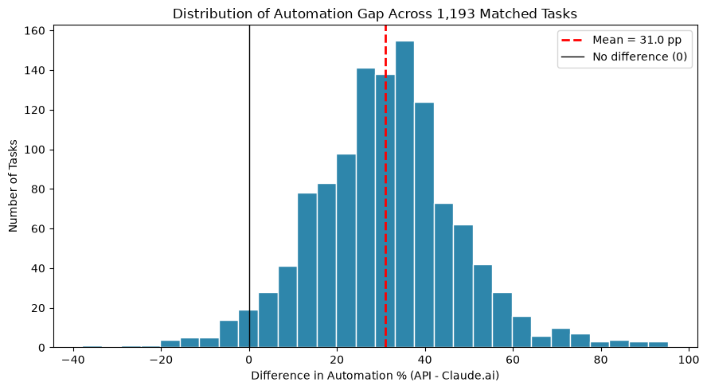

The histogram above shows the difference in automation percentage
(API − Claude.ai) for all 1,193 matched tasks. Almost all tasks fall to the
right of zero, meaning the API automation share is higher than Claude.ai's
for nearly every task, not just on average. The distribution is roughly
bell-shaped and centered near the mean (31.0 pp), which supports using a
paired t-test — the test assumes the differences are roughly normally
distributed. The small number of tasks on the left side (negative values)
represent the few cases where Claude.ai had a higher automation share than
the API.

## Regression Model

To control for other factors, I extended the paired t-test into a multiple
linear regression. Each matched task appears twice (once per platform),
giving 2,386 observations (1,193 tasks × 2 platforms).

    automation_pct = β0 + β1·api + β2·log_volume + ε

- `api`: dummy variable (1 = 1P API, 0 = Claude.ai)
- `log_volume`: log of the task's conversation count on that platform
- Standard errors are clustered by task, since the two rows of a task are
  not independent.

### Robustness Checks

| | (1) api only | (2) + log_volume | (3) + unclassified |
|---|---|---|---|
| api | 31.029*** | 31.082*** | 31.847*** |
| log_volume | | 0.181 | -2.207*** |
| unclassified_pct | | | -0.491*** |
| R² | 0.475 | 0.475 | 0.555 |
| N | 2,386 | 2,386 | 2,386 |

*** p < 0.01

The API coefficient stays between 31 and 32 percentage points and is
significant at the 1% level in every specification. Model (1) reproduces
the paired t-test (mean difference = 31.03 pp). The gap is not explained by
usage volume or by the share of unclassified conversations.

The sign change of `log_volume` between models (2) and (3) is an example of
omitted variable bias: high-volume tasks have a lower unclassified share,
so `log_volume` was partly picking up the effect of `unclassified_pct`.
## How Do They Differ? Collaboration Types on the Same Task

The regression shows *that* businesses automate more. The next question is
*how*: which kinds of collaboration does the API use more, and which does
Claude.ai use more? For each of the 1,193 matched tasks, I compared the five
collaboration types one by one (`src/how_and_negatives.py`). For each type I
ran the same regression as the main model
(`share = β0 + β1·api + β2·log_volume + ε`, standard errors clustered by task).

| Collaboration type | Claude.ai (mean %) | API (mean %) | API coefficient (pp) | API higher in | Claude.ai higher in |
|---|---|---|---|---|---|
| Directive | 40.8 | 72.8 | **+31.6** | 97.6% of tasks | 2.4% of tasks |
| Feedback loop | 2.9 | 1.9 | −0.5 | 8.4% | 23.6% |
| Learning | 17.5 | 3.5 | **−13.3** | 2.4% | 58.6% |
| Task iteration | 20.5 | 2.0 | **−18.0** | 0.5% | 74.5% |
| Validation | 3.5 | 1.9 | −1.3 | 5.8% | 29.6% |

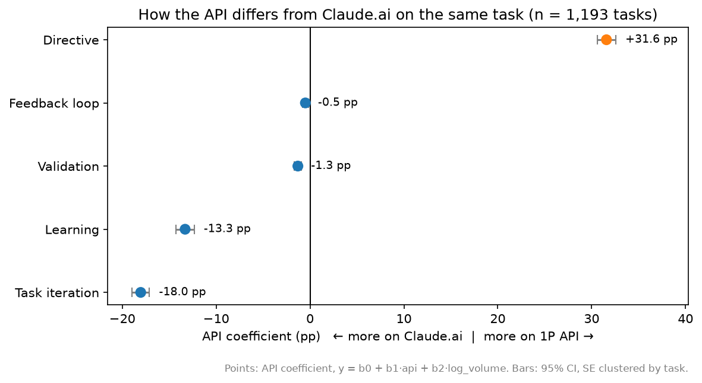

**Figure 4.** The API effect for each collaboration type, with 95% confidence
intervals. The automation gap comes almost entirely from **directive** use.
Feedback loop, the second automation type, barely differs. On the other side,
the API loses mostly **task iteration** and **learning**.

### Interpretation

On the same task, businesses mostly give Claude a single instruction and take
the result (directive). Consumers work on the task together with Claude,
refining the output over several turns (task iteration) or using it to
understand the topic (learning). In other words, the difference is not
"more automation in general", it is **one-shot delegation vs. working
together**.

Note:

- The five shares and the unclassified share add up to 100% within a task,
  so the coefficients balance each other: what the API gains in directive,
  it loses mainly in task iteration and learning.

## Exceptions: Tasks Where Claude.ai Automates More

In 37 of the 1,193 tasks (3.1%), Claude.ai has a *higher* automation share
than the API.

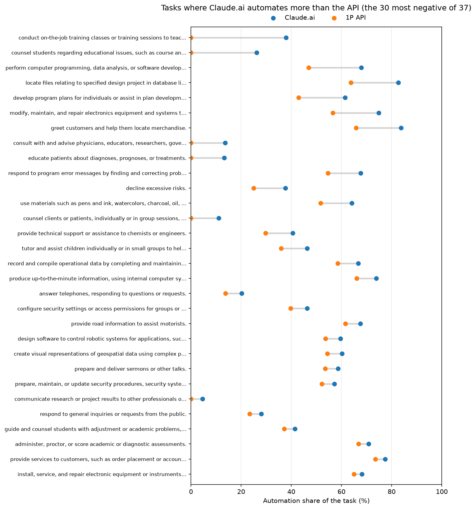

**Figure 6.** The 30 most negative tasks. Blue = Claude.ai, orange = 1P API.
In 7 tasks the API automation share is exactly 0%. The full list is in
`tables/negative_tasks.csv`.

### What Kind of Tasks Are They?

Looking at the task texts, two groups stand out:

- **Education and counseling:** training sessions, counseling students,
  educating patients, counseling clients, tutoring children, preparing and
  grading tests.
- **Technical support and repair:** repairing electronics, fixing program
  errors, calibrating equipment.

A possible explanation for the first group is that businesses use the API
inside products that are designed to teach or support a person (for example
education or counseling apps), so even business use looks like augmentation.
The data cannot prove this, but it fits the pattern.

## Replication on a Second Release (Feb 2026)

Everything up to this point used one week of data: Aug 4–11, 2025, from the
`release_2025_09_15` files. A result from a single week could be an accident of
that week. To check this, I repeated the whole analysis on a second release,
`release_2026_03_24`, which covers Feb 5–12, 2026 — six months later, with
newer models serving the traffic.

### What I did

I did not change the method. The Week 9–10 section of `src/profile.py` reuses the same rules as
Weeks 4–8:

- Automation = directive + feedback loop; Augmentation = learning + task
  iteration + validation.
- Task-level data only (`facet == "onet_task::collaboration"`,
  `variable == "onet_task_collaboration_pct"`), global level, `cluster_name`
  split into task name and collaboration type.
- A task is kept only if it has classified conversations on *both* platforms.
- One-tailed paired t-test, then `automation_pct = β0 + β1·api + β2·log_volume + ε`
  with standard errors clustered by task.

The only thing that changes is the input file. The script also re-runs
August 2025 through the identical code, so both periods come out of one
pipeline. As a check, it reproduces the Week 4–8 numbers exactly: 1,193
matched tasks, mean difference 31.03 pp, t = 63.26, api coefficient 31.082.
That tells me the comparison below is a real comparison and not an artifact of
two slightly different scripts.

The February files are much bigger — 477,717 rows for Claude.ai and 195,156 for
the API, against 100,062 and 33,794 in August — and they contain 30 facets that
did not exist in the first release.

### Automation vs Augmentation, Feb 2026

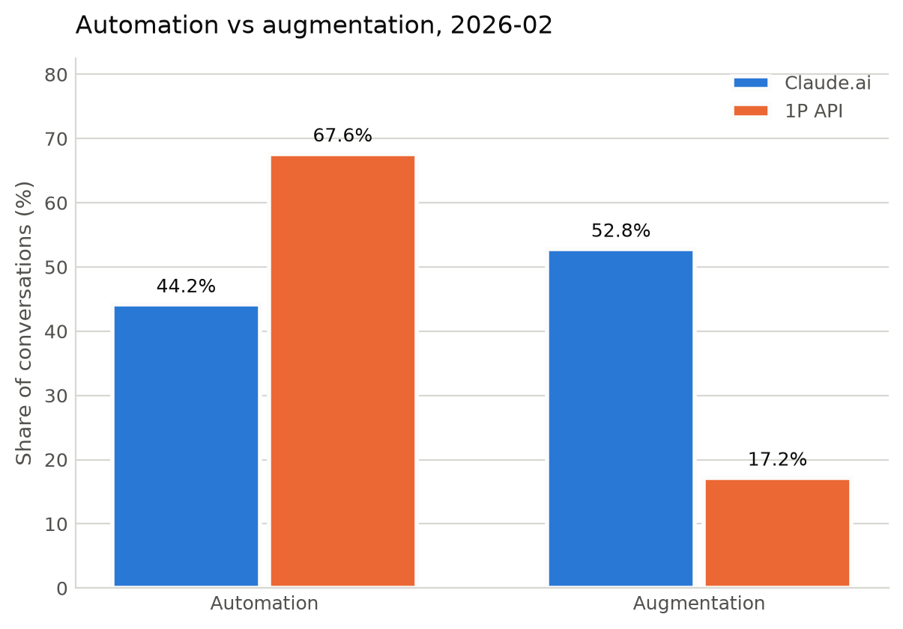

**Figure 7.** The same comparison as Figure 2, on the newer data. The API is
still far more automation-heavy than Claude.ai (67.6% vs 44.2%), and Claude.ai
is still the more augmentation-heavy platform (52.8% vs 17.2%).

Compared with August, both platforms moved in the same direction: automation
fell (API 77.4% → 67.6%, Claude.ai 49.1% → 44.2%) and augmentation rose. So the
*levels* are not stable across releases. The question is whether the *gap* is.

### Hypothesis Test

Same hypotheses as before, on the February data:

| | Statement |
|---|---|
| **H0** | `mean(diff) = 0` |
| **H1** | `mean(diff) > 0`, where `diff(t) = automation%_API(t) − automation%_ClaudeAI(t)` |

| Metric | Aug 2025 | Feb 2026 |
|---|---|---|
| Matched tasks (n) | 1,193 | **1,359** |
| Mean diff (API − Claude.ai) | +31.03 pp | **+29.97 pp** |
| Median diff | +31.43 pp | +30.70 pp |
| Std. dev. of diff | 16.94 pp | 19.90 pp |
| t-statistic | 63.26 | **55.52** |
| p-value | < .001 | **< .001** |
| Tasks with diff < 0 | 37 (3.1%) | 91 (6.7%) |
| Conclusion | Reject H0 | **Reject H0** |

H0 is rejected again. 166 more tasks are matched this time, and the mean gap is
about one percentage point smaller.

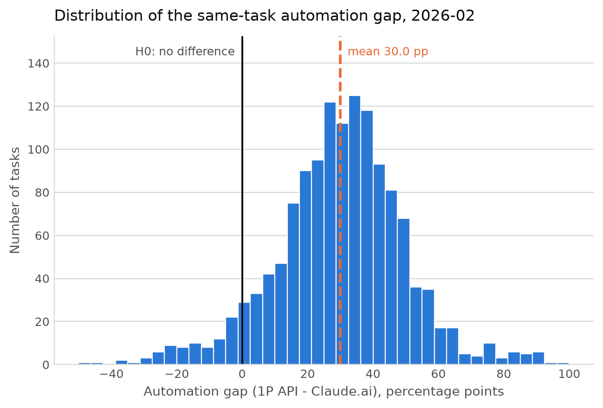

**Figure 8.** The February version of the Week 4–5 histogram. The distribution is still
roughly bell-shaped and still sits almost entirely to the right of zero. It is
a bit wider than the August one (sd 19.9 pp vs 16.9 pp) and has a longer left
tail, which is the 6.7% of tasks where Claude.ai automates more.

### Regression Model

Each matched task appears twice, once per platform: 2,718 observations
(1,359 × 2) for February, against 2,386 for August.

| | Aug (1) | Aug (2) | Aug (3) | Feb (1) | Feb (2) | Feb (3) |
|---|---|---|---|---|---|---|
| api | 31.029*** | 31.082*** | 31.847*** | 29.965*** | 29.893*** | 31.684*** |
| log_volume | | 0.181 | −2.207*** | | −0.219 | −3.190*** |
| unclassified_pct | | | −0.491*** | | | −0.538*** |
| Intercept | 43.647*** | 42.691*** | 62.616*** | 39.295*** | 40.437*** | 64.761*** |
| R² | 0.475 | 0.475 | 0.555 | 0.427 | 0.428 | 0.526 |
| N | 2,386 | 2,386 | 2,386 | 2,718 | 2,718 | 2,718 |

*** p < 0.01. Standard errors clustered by task.

Two things to read out of this table:

1. **The api coefficient survives.** It is between 29.9 and 31.8 pp in every
   specification in both periods, and significant at the 1% level each time.
2. **Controlling for unclassified conversations closes the difference.** In
   model (3) the two periods are almost identical — 31.847 vs 31.684. The
   unclassified share rose between releases (API 17.9% → 21.6%), and once that
   is held constant the periods line up. So the one-point drop in models (1)
   and (2) looks like a measurement change, not a behavioural one.

The `log_volume` sign change between models (2) and (3) repeats in February
(−0.219 → −3.190), the same omitted-variable-bias pattern I found in Week 6–7.
Usage volume still does not explain the gap on its own.

### Which Collaboration Types Drive the Gap

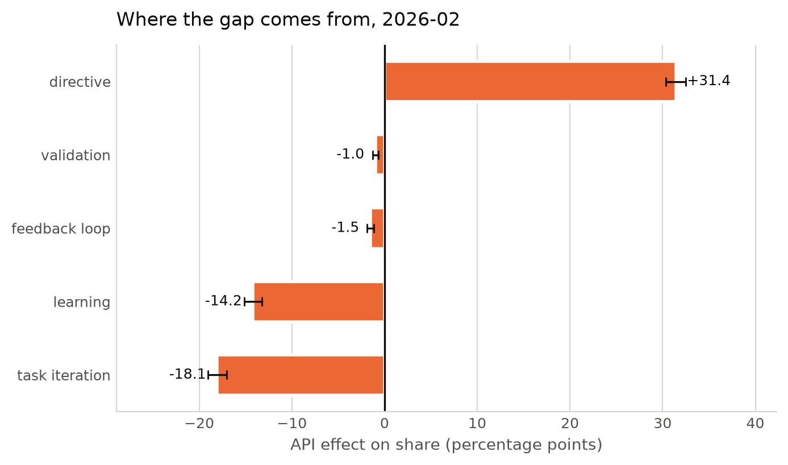

**Figure 9.** The February version of Figure 4: one regression per
collaboration type, same specification as the main model, with 95% confidence
intervals. The shape is the same — the API gains directive and loses task
iteration and learning.

| Collaboration type | Claude.ai (mean %) | API (mean %) | API coefficient (pp) | API higher in |
|---|---|---|---|---|
| Directive | 35.6 | 67.7 | **+31.4** | 94.6% of tasks |
| Feedback loop | 3.7 | 1.6 | −1.5 | 5.5% |
| Validation | 3.1 | 1.7 | −1.0 | 7.3% |
| Learning | 18.0 | 3.0 | **−14.2** | 1.7% |
| Task iteration | 23.2 | 4.4 | **−18.1** | 5.4% |

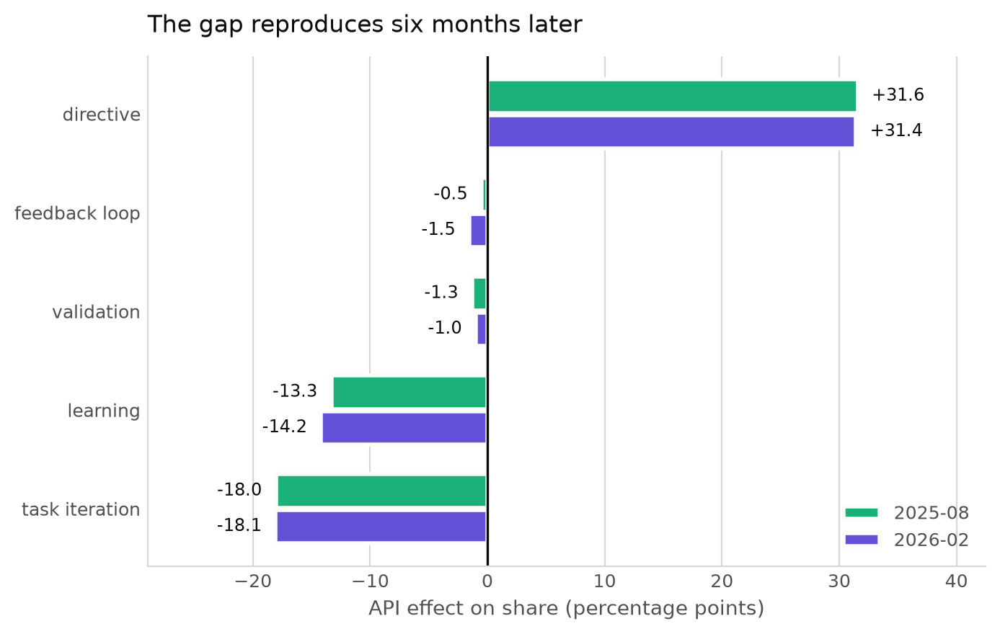

**Figure 10.** The two periods side by side. Each pair of bars is one
collaboration type: green is Aug 2025, purple is Feb 2026. The coefficients sit
within about one percentage point of each other in every category — directive
+31.6 vs +31.4, task iteration −18.0 vs −18.1, learning −13.3 vs −14.2.

This is the main result of the replication. Six months apart, with different
models and 166 more matched tasks, the decomposition reproduces almost exactly.
The "one-shot delegation vs. working together" interpretation from Week 8 is
not a feature of one particular week of data.

### Limitations

The two releases are close but not identical, and three differences matter:

1. **The consumer pool changed.** `platform_and_product` went from
   "Claude AI (Free and Pro)" to "Claude AI (Free, Pro, and Max)". The Max tier
   did not exist in the first file, so "consumer" is not exactly the same group
   of people.
2. **The business pool may have changed too.** The March 2026 report states
   that the 1P API sample includes Claude Code. The September 2025
   documentation does not mention Claude Code either way, so I cannot tell
   whether this is a change in the data or only a change in the documentation.
   If it is a change, part of the February directive share comes from coding
   agents rather than from ordinary business API use.
3. **Classification got noisier.** The unclassified share rose on both
   platforms, and the number of tasks where Claude.ai automates more doubled
   from 3.1% to 6.7%. These move together, which supports the Week 8 reading
   that many of those exception tasks are a measurement effect. Model (3) above
   is the direct evidence: once the unclassified share is controlled for, the
   difference between the periods nearly disappears.

Because of these, I ran the two periods separately and compared coefficients
rather than pooling them into one regression.

### What the February Release Makes Possible

The newer release adds facets the first one did not have: `use_case`
(work / personal / coursework), `ai_autonomy`, `task_success`, `multitasking`,
`human_only_ability`, and estimated task times with and without AI. The most
useful of these for this project is `use_case`, because it can test the
assumption the whole design rests on — that Claude.ai traffic is consumer use
and 1P API traffic is business use — rather than assuming it.

## Ruling Out the Alternative Explanation (Feb 2026)

The replication in the previous section shows the automation gap is stable.
It does not show *why* the gap exists. Two objections were still open, and
both can now be tested with facets that the August release did not have.

The February release adds `use_case` (work / personal / coursework) and
`human_only_ability` (could the user have completed the task without Claude?).
The Week 11 section of `src/profile.py` uses both, on the same 1,359 matched
tasks and the same panel as the Week 9 regression.

### Is the Consumer/Business Proxy Correct?

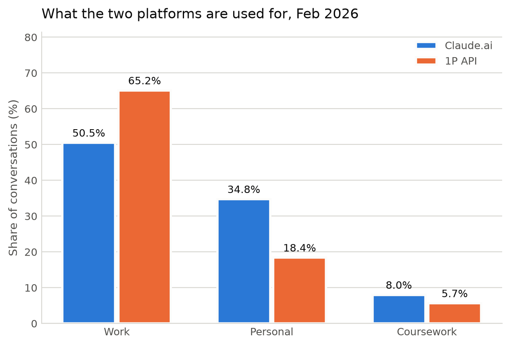

**Figure 11.** Purpose of use on the same tasks. The API is far more
work-oriented; Claude.ai carries most of the personal and coursework use.

| Use case | Claude.ai | 1P API | Difference | p |
|---|---|---|---|---|
| Work | 50.5% | 65.2% | **+14.6 pp** | < .001 |
| Personal | 34.8% | 18.4% | **−16.3 pp** | < .001 |
| Coursework | 8.0% | 5.7% | −2.3 pp | < .001 |

Measured over all conversations rather than matched tasks, the split is
sharper still: the API is 74.2% work and 20.1% personal, while Claude.ai is
45.2% work and 42.3% personal.

It is not a clean separation, though. Half of Claude.ai use (50.5%) is still
work, and 18.4% of API use is still personal. The two populations overlap. If
consumer and business behaviour are mixed inside both platforms, then the true
difference between consumers and businesses is probably **larger** than the
30 pp I measure, not smaller — mixing pulls the two groups toward each other.

### Could the User Have Done It Without Claude?

| Could the user have done it alone? | Claude.ai | 1P API | Difference | p |
|---|---|---|---|---|
| Yes | 90.8% | 94.3% | +3.5 pp | < .001 |
| No | 5.8% | 2.3% | −3.5 pp | < .001 |

On the same task, businesses are more often handing over work the person could
already have done themselves. Consumers use Claude for things they could not
do alone about two and a half times as often.

This is a separate measure from collaboration type, and it points the same way
as Week 8: the high `learning` share on Claude.ai and the high `no` share here
are two different ways of seeing the same behaviour — consumers reaching for
Claude when the task is beyond them, businesses delegating work that is
already routine.

### Does the Gap Survive These Controls?

The direct test is to put both variables into the Week 9 regression as
controls and see what happens to the api coefficient:

    automation_pct = β0 + β1·api + β2·log_volume + β3·unclassified_pct
                     + β4·work_pct + β5·human_only_yes_pct + ε

Same panel as before — 2,718 observations, 1,359 tasks × 2 platforms, standard
errors clustered by task.

| | (1) Week 9 | (2) + work | (3) + ability | (4) + both |
|---|---|---|---|---|
| api | 31.684*** | **30.161*** | 31.974*** | **30.410*** |
| work_pct | | 0.099*** | | 0.098*** |
| human_only_yes_pct | | | −0.086* | −0.071 |
| log_volume | −3.190*** | −3.083*** | −3.212*** | −3.102*** |
| unclassified_pct | −0.538*** | −0.516*** | −0.537*** | −0.515*** |
| Intercept | 64.761*** | 58.845*** | 72.713*** | 65.422*** |
| R² | 0.526 | 0.543 | 0.527 | 0.543 |
| N | 2,718 | 2,718 | 2,718 | 2,718 |

*** p < 0.01, * p < 0.1. Standard errors clustered by task.

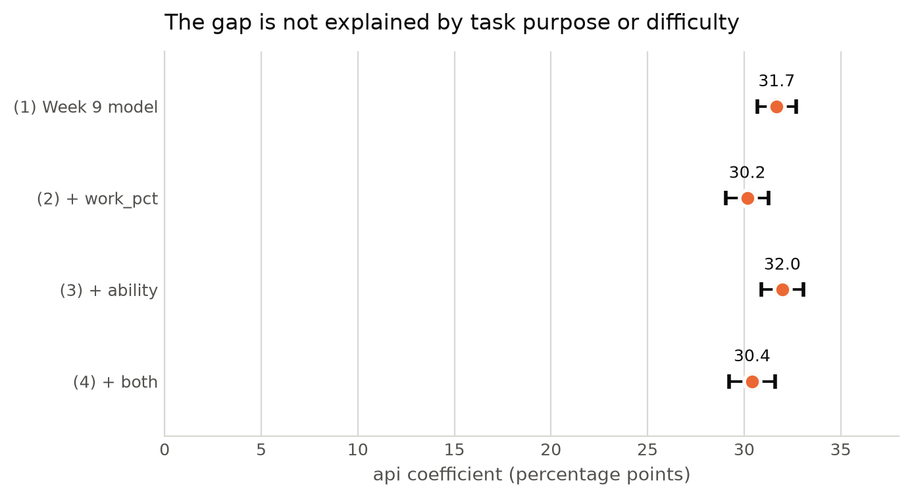

**Figure 13.** The api coefficient with 95% confidence intervals in each
specification. It stays near 30 pp whatever is controlled for.

Reading the table:

- **Task purpose matters, but only a little.** `work_pct` is significant: a
  task that is 10 pp more work-oriented is about 1 pp more automated. Adding
  it moves the api coefficient from 31.68 to 30.16. So purpose explains about
  1.5 pp of a 31.7 pp gap and leaves 30 pp unexplained.
- **Difficulty explains nothing.** `human_only_ability` is marginal on its own
  (p < 0.1) and not significant once `work_pct` is in the model. Model (3)
  even nudges the api coefficient slightly up.
- **The coefficient is stable.** Across all four specifications it stays
  between 30.2 and 32.0 pp, significant at the 1% level every time.

The two platforms are not simply doing different kinds of work. Holding purpose, difficulty, usage volume and classification quality constant, business API use is still about 30 percentage
points more automation-heavy than consumer use on the same O*NET task.
